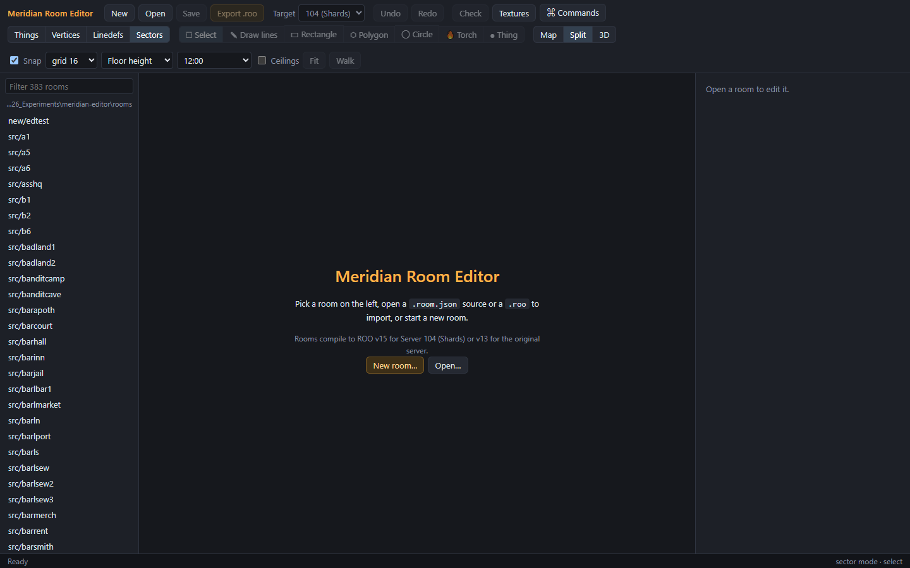

# Getting started

## Install the editor

### Windows

Download the installer for your system from the [releases page](https://github.com/jboullion/meridian-editor/releases) (the newest release is at the top).

1. Run `Meridian-Room-Editor-Setup-<version>.exe`.
2. The installer isn't code-signed yet, so Windows SmartScreen may warn about an unrecognised app. Choose **More info**, then **Run anyway**.
3. Pick a folder, or keep the default. The editor installs for your user only, and adds a desktop shortcut.

### macOS and Linux

- **macOS:** open `Meridian-Room-Editor-<version>-mac.dmg` and drag the editor to Applications. It isn't signed yet, so the first time, right-click it in Applications and choose **Open**, then **Open** again.
- **Linux:** the `.AppImage` runs as it is (make it executable first: `chmod +x`), or install the `.deb` with your package manager.

On macOS and Linux there's no default textures folder. Set one in Preferences (see [Textures](#textures) below).

### Updating

The editor checks for a new version each time it starts.

- **Windows and the Linux AppImage:** it downloads the new version in the background, and the status bar says when it's ready. It installs when you quit the editor, or right away from **Help → Restart to Update**. If the room has unsaved changes, the editor asks first.
- **macOS and the `.deb`:** the status bar says a new version is out. **Help → Check for Updates** opens its download page; install it the way you installed this one.

**Help → Check for Updates** checks again at any time, and **Help → About** shows which version you have.

## First launch

The editor opens with the welcome screen:

- **Room list** (left): every room source (`.room.json`) in your rooms folder and its subfolders. Click one to open it. Type in the box at the top to filter the list.
- **New room…**: start an empty room. See [Files](05-files.md#new-room).
- **Open…**: open a room source from anywhere, or import a compiled `.roo`.

## The rooms folder

The installed editor keeps rooms in `Documents\Meridian Rooms`, and creates that folder the first time it runs. To use another folder, choose **Folder…** beside the room list's filter box, or **File → Open Rooms Folder…**. The editor remembers the folder you pick.

Rooms are saved as text sources, `<name>.room.json`. These are what you keep, share and put in version control. The compiled `.roo` file the server loads is made from the source when you export (see [Checks and export](11-checks-and-export.md#export-a-roo)).

## Textures

The editor draws walls, floors and ceilings with the game's own textures (`grdNNNNN.bgf` files). On Windows it reads them from the installed Meridian 59 (104) client, in `%LOCALAPPDATA%\Meridian-104\resource`. If the client is installed, there's nothing to set up.

To use another folder:

1. Open **File → Preferences…** (Ctrl+,).
2. Set **Textures folder** to a folder of `grdNNNNN.bgf` files.
3. Choose **Save**. The texture library reloads.

Without textures the editor still works, but every face in the 3D preview shows a grey checker and texture fields show no swatches.

## Kod (optional)

A room's exits, monster generators, objects, sounds and light sources aren't in the room file. They're placed by the room's class in the server's Kod source. If you have the Shards server source, the editor can read it and show those placements on the map, and use the room's Kod light settings in the 3D preview.

1. Open **File → Preferences…**.
2. Set **Kod folder** to the Shards server's `server/src/kod` folder.
3. Choose **Save**.

See [Kod placements](10-kod-placements.md) for what this gives you. Without a Kod folder, the Kod tab says "none" and the preview uses the default room lighting.

## Opening rooms from Explorer or Finder

The editor can open rooms from your file manager, but it doesn't take over `.json` files:
- **Windows:** right-click a `.room.json` or `.roo` file and choose **Open with → Meridian Room Editor**. You can also drop a file on the editor's icon.
- **macOS:** use **Open With** on a `.json` or `.roo` file.
- **Linux:** the editor is offered for JSON files.

If the editor is already running, the room opens in that window.

---

Next: [The editor window](02-the-window.md)
