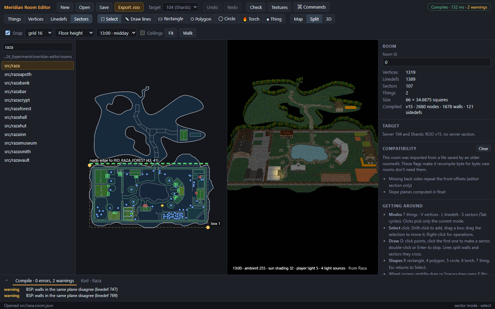
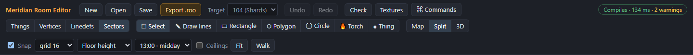
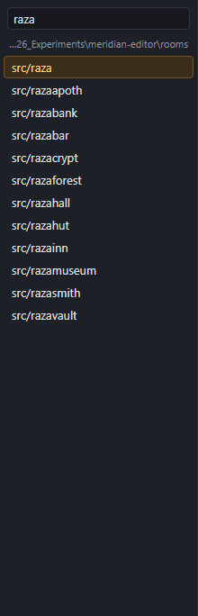
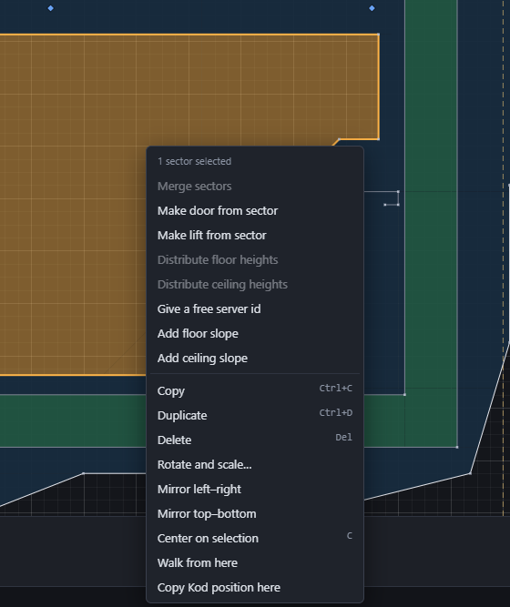
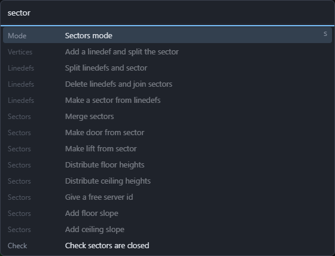
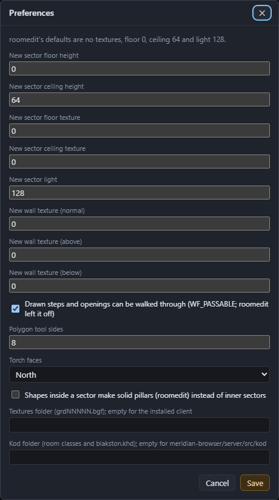

# The editor window

From top to bottom:
- the **toolbar**: buttons and settings, in two rows (three in a narrower window);
- the **room list** (left), the **views** (middle) and the **inspector** (right);
- the **bottom panel**, with tabs for compile results, check results and the room's Kod;
- the **status bar**.

## The toolbar

**First row:**

| Control | What it does |
|---|---|
| New, Open, Save | Start a room, open one, save the room source. Save shows a dot (•) when there are unsaved changes. |
| Export .roo | Compile the room for the target and save the `.roo` file. |
| Target | **104 (Shards)** or **Original**: the server you're building for. See [Room basics](03-room-basics.md#targets). |
| Undo, Redo | Step back and forward through your changes. |
| Check | Run all of roomedit's checks (F9). |
| Textures | Browse the texture library. |
| ⌘ Commands | The command palette: every command, searchable (Ctrl+Shift+P). |
| Compile chip (right) | Green **Compiles · N ms** when the room compiles for the target; red **N errors** when it doesn't. Warnings are counted after it. The room recompiles after every change. |

**Second row** (it wraps onto a third in a narrower window):

| Control | What it does |
|---|---|
| Things, Vertices, Linedefs, Sectors | The edit **mode**: what clicks on the map select (T, V, L, S). |
| Select, Draw lines, Rectangle, Polygon, Circle, Torch, Thing | The **tool** for the map (Q, D, R, 4, 5, 6, 7). |
| Map, Split, 3D | Which **views** to show (Ctrl+1, Ctrl+3, Ctrl+2). |
| Snap, grid | Snap to the grid, and the grid size. 64 is one Kod square. |
| Floor height / Ceiling height / Light | What the map shades sectors by. |
| Hour | The game hour for the 3D preview's lighting, or **Flat light**. |
| Ceilings | Show ceilings in the 3D preview. |
| Fit | Fit the whole room in the map (F). |
| Walk | Walk the room in the 3D preview (Shift+W). |

## The room list

Every `.room.json` in the rooms folder, including subfolders. Type in the filter box to narrow the list, and click a room to open it. If the open room has unsaved changes, the editor asks first. The line under the filter shows the rooms folder; **Folder…** changes it.

## The views

- **Map** (Ctrl+1): the room from above. This is where you select and draw. See [Selecting and drawing](06-drawing-and-selecting.md).
- **3D** (Ctrl+2): the room as the client draws it. See [3D preview and walking](09-3d-preview-and-walking.md).
- **Split** (Ctrl+3): both side by side.

On the map:
- the mouse wheel zooms, and middle-drag or Space+drag pans;
- **F** fits the room, and **C** centres on the selection;
- **+** and **−** zoom in and out;
- **H** shows or hides the grid.

## The inspector

The right-hand panel shows the properties of whatever is selected. With nothing selected, it shows the room: its Room ID, counts, size, what it compiled to, and a short "Getting around" reminder. See [The inspector](07-inspector.md).

## The bottom panel

The bottom panel has three tabs:
- **Compile**: errors and warnings from compiling the room for the target.
- **Checks** (named after the check that ran, such as **All checks**): the results of the last check. Click a result to select and show the problem. Some results have a button that fixes them. **Clear** closes the tab.
- **Kod**: the room's class in the server's Kod and everything it places. See [Kod placements](10-kod-placements.md).

The ▾ button at the left folds the panel away.

## The status bar

The status bar shows the last message on the left (what the editor just did, or what went wrong). On the right it shows:
- the mode and tool;
- the selection;
- the cursor's position in room units, with its Kod row and column;
- what the room's Kod puts on that square, when Kod placements are shown.

## The right-click menu

Right-click the map for the operations that fit the current mode and selection. If what you click isn't selected, it gets selected first.

The top part holds the mode's own operations (here, sector operations such as Make door and Add floor slope). The bottom part holds the ones every mode has: copy, delete, rotate, mirror, walk from here and copy the Kod position. Greyed-out items need a different selection; for example, **Merge sectors** needs two or more sectors.

## The command palette

**Ctrl+Shift+P** (or F1, or **⌘ Commands**) lists every command with its shortcut. Type to filter, use the arrow keys to move, and press Enter to run one.

## The menu bar

The desktop app's menus (File, Edit, Modes, Tools, Search, Check, View, Help) run the same commands as the toolbar and the palette. **File → Preferences…** sets the defaults for new sectors and walls, the drawing tools, and the textures and Kod folders. **Help** checks for updates and shows the version (see [Updating](01-getting-started.md#updating)).

---

Previous: [Getting started](01-getting-started.md) · Next: [Room basics](03-room-basics.md)
