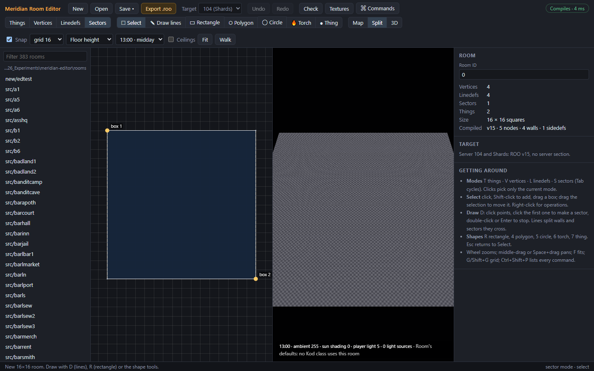
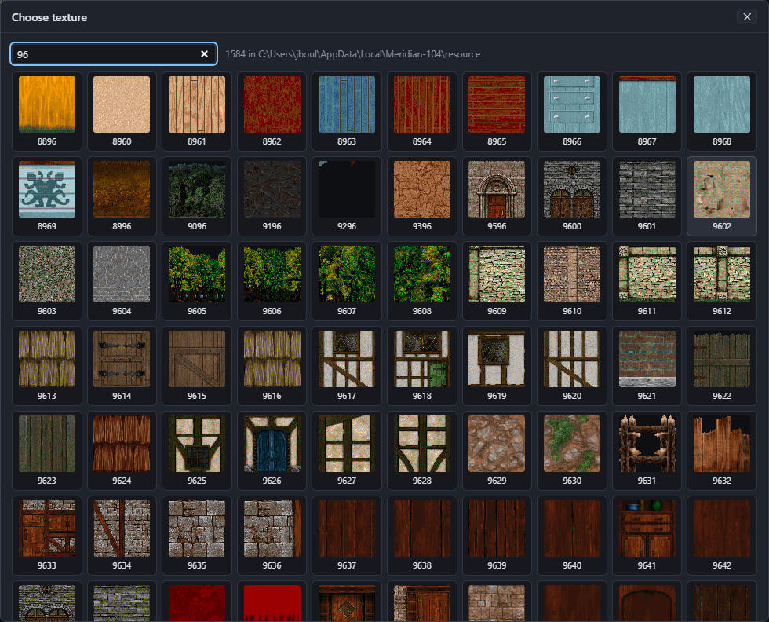
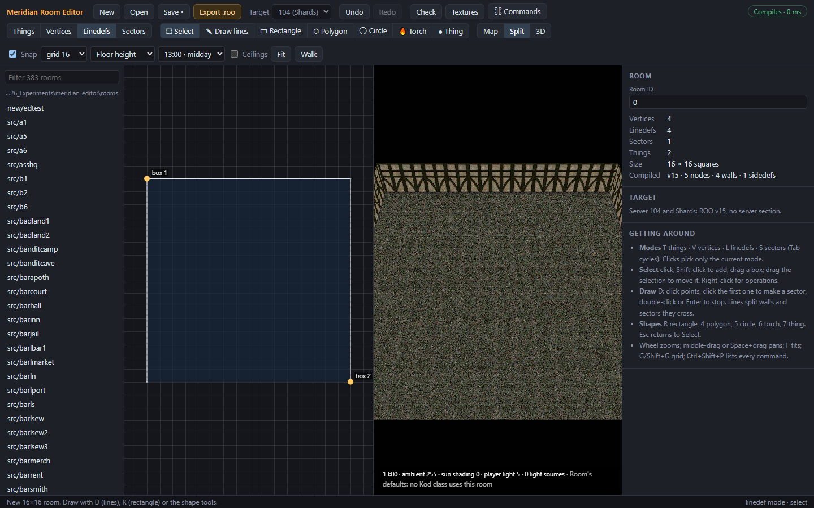
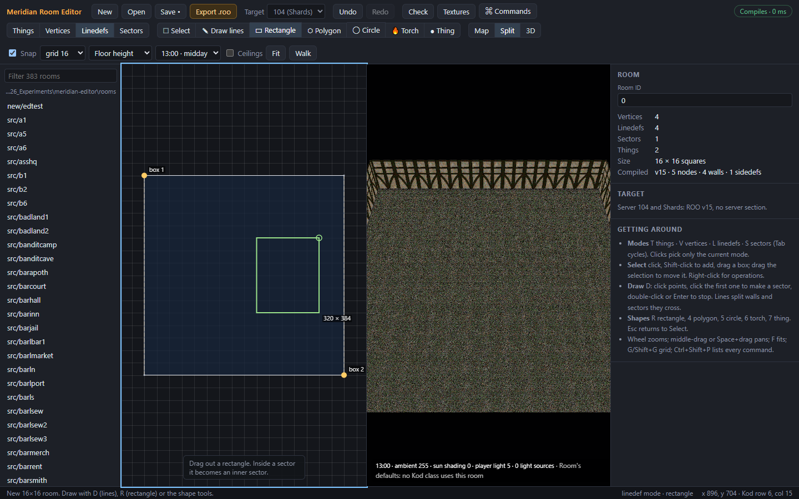
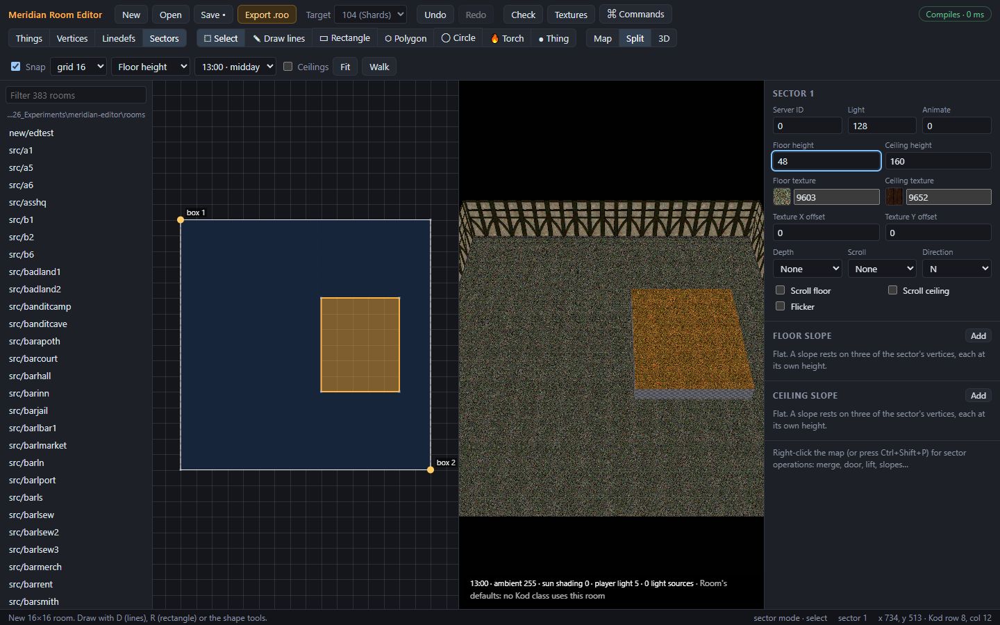
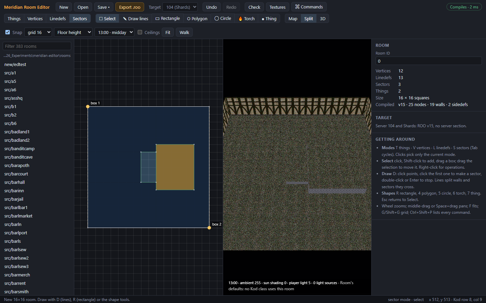
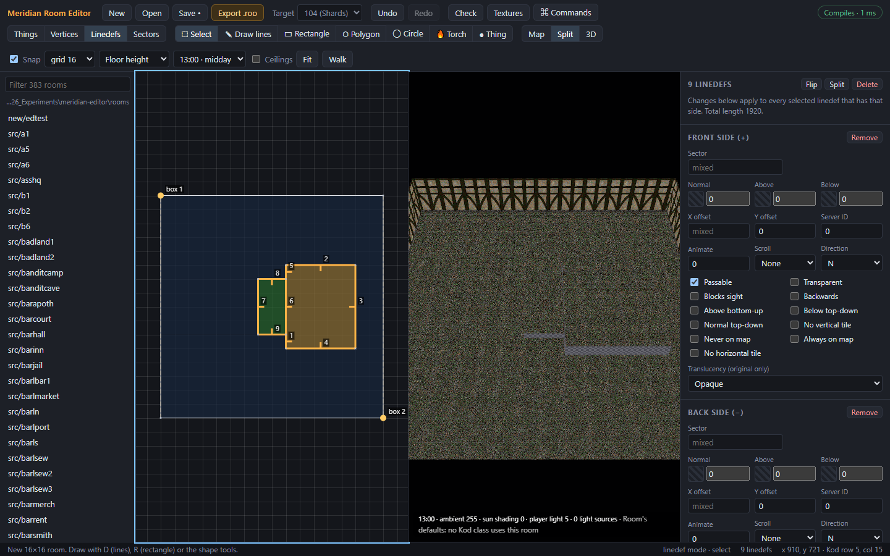
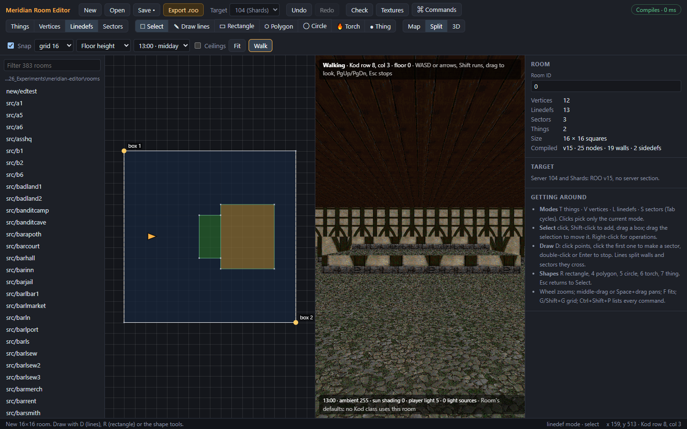
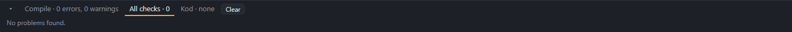

# Tutorial: your first room

This tutorial builds a small indoor room with a raised platform and a step up to it. Then you walk round it, check it and export it. It takes about ten minutes.

You'll use:
- the **New room** dialog;
- the **inspector** and the **texture picker**;
- the **Rectangle** tool;
- **box selection** in Linedefs mode;
- **Walk** mode, the **checks** and **Export .roo**.

## 1. Make a new room

1. Choose **New** in the toolbar (Ctrl+N).
2. Name the room `tutorial`. Keep the size, 16 × 16 squares, and keep **Start with one sector filling the room** ticked.
3. Choose **Create**.

The room appears on the map: one sector filling the room box, with the two room box corners (**box 1** and **box 2**) at its top-left and bottom-right.

Switch to **Split** view (Ctrl+3) to see the map and the 3D preview side by side. The 3D preview shows grey checkers, because nothing has a texture yet.

## 2. Give it a floor, a ceiling and walls

**The floor and ceiling:**

1. Choose **Sectors** mode (S) and click inside the room. The inspector shows **Sector 0**.
2. Click the swatch beside **Floor texture**. The texture picker opens. Type `96` in its filter box and pick a floor texture, such as **9603** (Raza's paving). You can also type the number straight into the field and press Enter.

   

3. Set **Ceiling texture** to **9652** (wooden beams).
4. Set **Ceiling height** to **160** and press Enter. New rooms start with a ceiling at 64, which is low for a room with a platform in it.

**The walls:**

1. Choose **Linedefs** mode (L) and press **Ctrl+A** to select every linedef.
2. In the inspector's **Front side (+)** section, set **Normal** to **9628** (the inn's timber walls).
3. Press **Esc** to clear the selection.

Number fields commit when you press Enter or click elsewhere, and each change is one step for **Undo** (Ctrl+Z).

## 3. Add a platform

1. Choose the **Rectangle** tool (R).
2. Drag a rectangle inside the room, on the right-hand side. The size shows as you drag, and the corners snap to the grid. A rectangle inside a sector becomes a new sector inside it.

   

3. Press **Esc** to go back to the Select tool, choose **Sectors** mode and click the new rectangle.
4. Set its **Floor height** to **48**.

The 3D preview shows the platform raised. It keeps the floor and ceiling textures of the sector it was drawn in.

## 4. Add a step

The platform is 48 high, but a player can only step up 24 at a time. Give them a step.

1. Choose the **Rectangle** tool again and drag a smaller rectangle against the platform's left edge. Where the two touch, the editor splits the platform's edge so the step and the platform share it.
2. Press **Esc**, then click the step in Sectors mode and set its **Floor height** to **24**.

## 5. Texture the step edges

The faces under each raised edge still show grey checkers: they need a **Below** texture.

1. Choose **Linedefs** mode (L).
2. With the Select tool, drag a box around the platform and the step. A box selects every linedef that's entirely inside it, so the room's outer walls aren't selected.
3. In the inspector, set **Below** to **9628** under both **Front side (+)** and **Back side (−)**. With several linedefs selected, a change applies to all of them. Fields where they differ show "mixed".

Linedefs that drawing makes two-sided are already **Passable**, so players can walk over the edges. (roomedit left this off; **Preferences** can turn it off too.)

## 6. Walk it

1. Right-click the map on the left of the room and choose **Walk from here**. You can also choose **Walk** in the toolbar (Shift+W), which starts on the Kod arrival square, or in the middle of the first sector if the room has no Kod yet.
2. Walk with **W A S D** or the arrow keys, hold **Shift** to run, and drag in the 3D view to look round.
3. Walk up the step onto the platform. Then try to climb straight onto the platform from the floor: 48 is too high, so the edge stops you, as it would in the game.
4. Press **Esc** to stop walking.

The map shows where you are and which way you're facing.

## 7. Check it

Choose **Check** in the toolbar (F9). This runs roomedit's checks: sectors are closed, cross-references are sound, and no walls are missing textures. The results show in the bottom panel.

If you skipped step 5, the checks list each step edge without a Below texture. Click a result to select it on the map.

## 8. Save and export

1. **Save** (Ctrl+S). A new room has no file yet, so the editor asks where to save `tutorial.room.json`. Save it in your rooms folder and it shows in the room list.
2. **Export .roo** (Ctrl+E). The editor compiles the room for the target in the toolbar and asks where to save `tutorial.roo`.

To use the room in the game, the server also needs a Kod class for it. See [Kod placements](10-kod-placements.md#new-rooms-and-kod).

## What next

- Make the room a different shape with the **Draw lines** tool (D). See [Selecting and drawing](06-drawing-and-selecting.md).
- Add a doorway, a lift or a sloped floor. See [Operations](08-operations.md).
- Try the hours in the toolbar's hour menu to see the room at night. See [3D preview and walking](09-3d-preview-and-walking.md).

---

Previous: [Room basics](03-room-basics.md) · Next: [Files](05-files.md)
