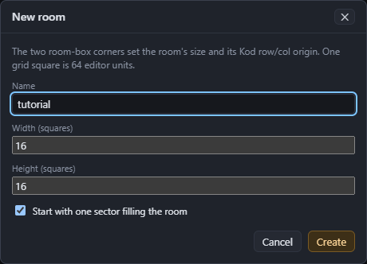

# Files

| Command | Shortcut | What it does |
|---|---|---|
| New room… | Ctrl+N | Start a new room. |
| Open… | Ctrl+O | Open a room source (`.room.json`), or import a compiled room (`.roo`). |
| Open rooms folder… | | Choose the folder the room list shows. |
| Save | Ctrl+S | Save the room source. |
| Save as… | Ctrl+Shift+S | Save the room source under a new name. |
| Compile and export .roo… | Ctrl+E | Compile the room for the target and save the `.roo`. |

They're in the **File** menu, and New, Open, Save and Export .roo are in the toolbar too.

## New room

- **Name**: the room's file name, without `.room.json`.
- **Width** and **Height**: the room box, in squares of 64 units (1 to 256).
- **Start with one sector filling the room**: draws a floor sector over the whole box. Untick it to start with only the room box and draw everything yourself.

The new sector uses the defaults from **Preferences**: floor 0, ceiling 64, light 128 and no textures, unless you've changed them.

A new room has no file until you save it. The first **Save** asks where to put it.

## Open a room

There are three ways to open a room:
- click it in the **room list**;
- choose **Open…** and pick a `.room.json` anywhere on disk;
- use **Open with** from your file manager (see [Getting started](01-getting-started.md#opening-rooms-from-explorer-or-finder)).

If the open room has unsaved changes, the editor asks before replacing it.

## Import a .roo

**Open…** also takes compiled rooms, version 12 to 15: the original game's rooms and Server 104's. The editor turns the `.roo` back into a room source. Rooms made by roomedit come back exactly: compiled again for their own target, nearly all of them give the same file, byte for byte.

An imported room has no source file yet. **Save** asks where to save `<name>.room.json`.

Rooms imported from older roomedit files may show a **Compatibility** section in the inspector (with nothing selected). It lists quirks of that roomedit version that the editor keeps so the room compiles exactly as it did. **Clear** drops them, and the room then compiles the way current roomedit does. New rooms never have them.

## Save

**Save** writes the room source. The toolbar's **Save •** and a ● in the window title mean there are unsaved changes. Closing the window with unsaved changes asks first.

## Export a .roo

**Export .roo** compiles the room for the toolbar's **Target** and asks where to save the `.roo`. It starts in the rooms folder, then remembers the last folder you exported to.

If the room doesn't compile for the target, nothing is saved, and the status bar shows the first error. The **Compile** tab in the bottom panel lists them all. See [Checks and export](11-checks-and-export.md).

## The rooms folder

The room list shows every `.room.json` in the rooms folder and its subfolders. The installed editor starts with `Documents\Meridian Rooms`. To change it, use **Folder…** beside the filter box, or **File → Open Rooms Folder…**.

## Where settings are kept

- The rooms folder and the export folder are in `settings.json`, in the editor's data folder (`%APPDATA%\Meridian Room Editor` on Windows).
- Preferences (sector and wall defaults, tool settings, the textures and Kod folders) are kept by the editor in the same data folder.

---

Previous: [Tutorial: your first room](04-tutorial-first-room.md) · Next: [Selecting and drawing](06-drawing-and-selecting.md)
