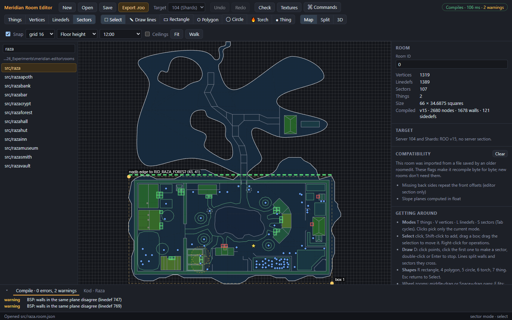
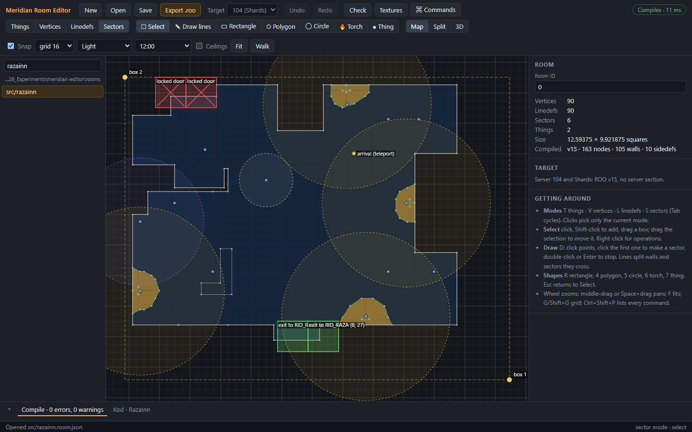
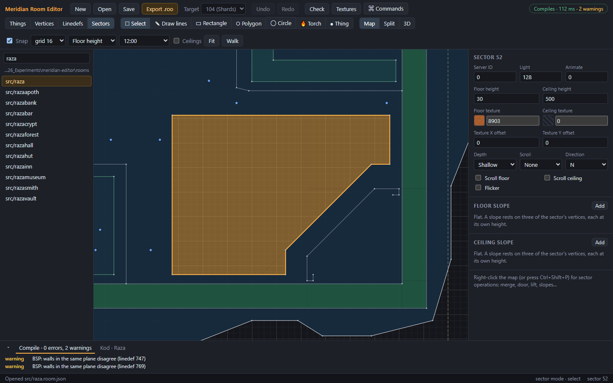
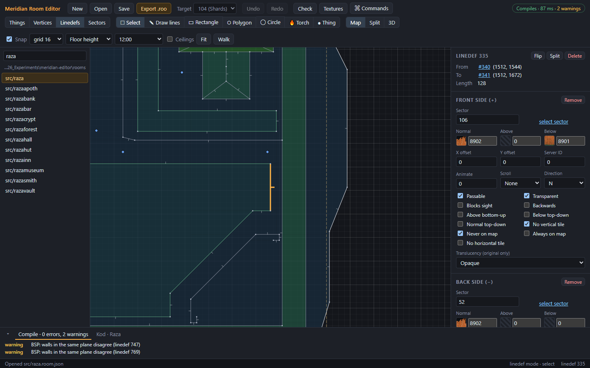
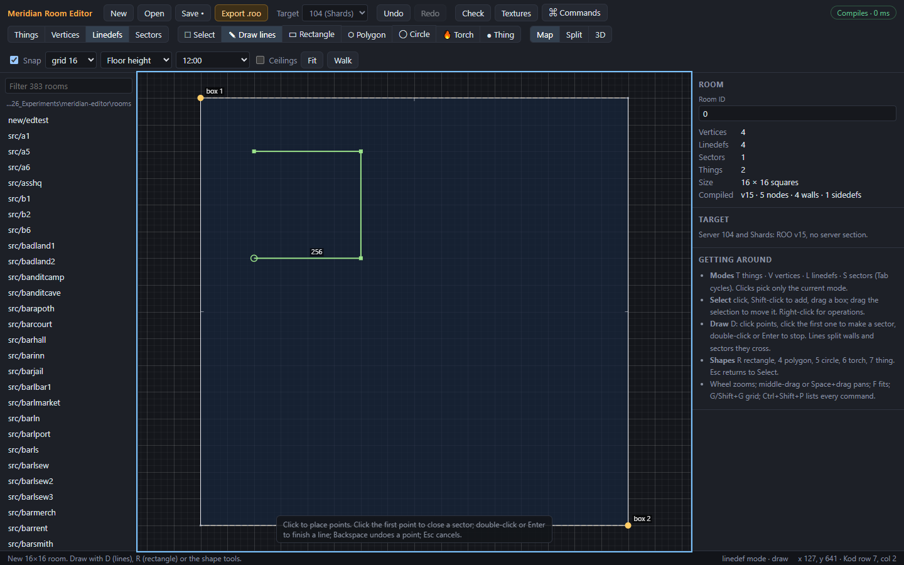
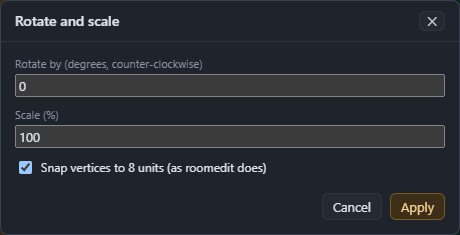

# Selecting and drawing

## Modes

The **mode** decides what you select on the map. Choose it in the toolbar or with a key:

| Mode | Key | Selects |
|---|---|---|
| Things | T | the room box corners (and any other things) |
| Vertices | V | points |
| Linedefs | L | lines |
| Sectors | S | areas |

**Tab** goes to the next mode and **Shift+Tab** to the previous one. Clicks pick only the current mode's items, so you can click a sector without catching the lines around it.

## Reading the map

- **Sectors are shaded** by floor height, ceiling height or light, picked in the toolbar. Low values are dark blue and high values are lighter, turning green and gold.
- **Linedefs are coloured** by kind: white for one-sided walls, grey for two-sided, green for passable, red for a linedef with no sides.
- **The room box** is the dashed rectangle between the two corners, **box 1** and **box 2**.
- **Kod placements** (exits, objects, the arrival square and more) show when the room has a Kod class. See [Kod placements](10-kod-placements.md).

## Selecting

With the **Select** tool (Q):

| To | Do this |
|---|---|
| Select one item | Click it. What's under the mouse is highlighted blue first. |
| Add or remove an item | Shift-click or Ctrl-click it. |
| Select everything in an area | Drag a box from empty space. It selects items entirely inside the box. Hold Shift to add to the selection. |
| Select everything in this mode | Ctrl+A |
| Clear the selection | Click empty space, or press Esc. |
| Step through items one by one | N (next) and P (previous) select each item of the mode in turn, and centre the map on it. |

The selection is drawn orange. The inspector shows its properties, and the status bar says what's selected.

## Moving

Drag the selection to move it. With **Snap** on, it moves in steps of the grid size.

When you drop moved vertices (in any mode except Things), the editor tidies up as roomedit did:
- a vertex dropped on another vertex **merges** into it;
- a vertex dropped on a linedef **splits** the linedef there;
- two linedefs left between the same two vertices merge into one.

To move by an exact amount, select several vertices or things and use **Move X by** and **Move Y by** in the inspector. To place a single vertex or thing exactly, type its **X** and **Y**.

## The grid

- **Snap** (Shift+H) snaps points to the grid as you draw and move.
- The grid size (1 to 256) is in the toolbar. **G** doubles it and **Shift+G** halves it. 64 is one Kod square, and the darker grid lines always mark every 64.
- **H** shows or hides the grid.

## Drawing tools

Pick a tool in the toolbar or with its key. **Esc** goes back to the Select tool. While a drawing tool is active, a hint at the bottom of the map says how to use it.

### Draw lines (D)

1. Click to place points. Each click adds a line from the last point.
2. Finish in one of two ways:
   - Click the first point again to close the shape. This makes a sector.
   - Double-click, or press **Enter**, to finish an open line.
3. **Backspace** removes the last point, and **Esc** cancels the line.

Points snap to existing vertices, to walls and to the grid. Lines you draw:
- split the walls they cross;
- divide the sectors they cut. A line drawn across a sector from wall to wall cuts it in two.

New sectors and walls take their heights, light and textures from **Preferences**, and new two-sided walls are **Passable** unless Preferences says otherwise.

### Rectangle (R), Polygon (4), Circle (5)

Drag to draw the shape:
- **Rectangle**: from one corner to the other. The size shows as you drag.
- **Polygon**: from the centre outwards. It has 8 sides; Preferences sets the number.
- **Circle**: from the centre outwards. The bigger the circle, the more sides it gets, as in roomedit.

Drawn inside a sector, a shape becomes an **inner sector**: a new area with its own heights, which you can raise into a platform or lower into a pit. With **Shapes inside a sector make solid pillars** ticked in Preferences, it becomes a solid **pillar** instead: a hole in the floor plan, with walls facing out.

A shape drawn against an existing sector's edge shares that edge, as the step does in the [tutorial](04-tutorial-first-room.md#4-add-a-step).

### Torch (6)

Click near a wall to place one of Meridian's wall torches: two crossed, animated textures on short see-through linedefs, as roomedit made them. Within 4 units of a wall, the torch snaps onto it. The direction it faces is set in Preferences (**Torch faces**).

### Thing (7)

Click to add a thing. With a thing other than a room box corner selected, the new one copies it.

Extra things are roomedit's notes for placing Kod objects, and only the original server's rooms keep them. **Server 104 only loads rooms with exactly two things**, so for the 104 target the room won't compile while there are more. Place objects in Kod instead (see [Kod placements](10-kod-placements.md)).

## Copy, cut, paste and duplicate

| Command | Shortcut | What it does |
|---|---|---|
| Copy | Ctrl+C | Copy the selection, with the sectors its linedefs face. |
| Cut | Ctrl+X | Copy, then delete. |
| Paste at cursor | Ctrl+V | Paste with the copy's top-left at the mouse, on the grid. |
| Duplicate | Ctrl+D | Copy and paste one square right of and below the original. |

The pasted items are selected, ready to drag into place. Sides that faced sectors outside the copy are left off.

## Delete

**Delete** (or Backspace) removes the selection, along with what depends on it, as roomedit did:
- deleting a **vertex** deletes the linedefs that use it;
- deleting a **linedef** deletes vertices nothing else uses;
- deleting a **sector** deletes the sides that face it, and linedefs left with no sides at all.

Deleting a room box corner asks first when the target is 104. The room box sets the room's size and the Kod rows and columns.

To remove a vertex but keep its two linedefs as one, or to remove a linedef and merge the sectors on either side, see [Operations](08-operations.md).

## Rotate, scale and mirror

- **Rotate and scale…** turns the selection about its centre, counter-clockwise by the angle you give, and scales it by a percentage. Vertices snap to multiples of 8, as roomedit did, unless you untick that.
- **Mirror left–right** and **Mirror top–bottom** flip the selection about its centre. Linedefs are flipped too, so their sides still face the right sectors.

These are on the right-click menu and in the **Edit** menu.

## Undo and redo

**Undo** (Ctrl+Z) and **Redo** (Ctrl+Y or Ctrl+Shift+Z) step through the last 200 changes. A drag counts as one change, and so does a value typed in the inspector.

---

Previous: [Files](05-files.md) · Next: [The inspector](07-inspector.md)
