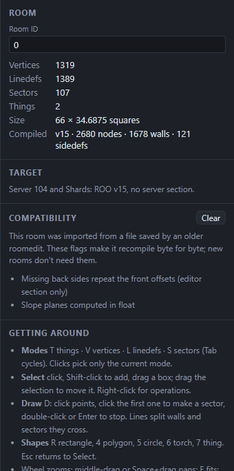
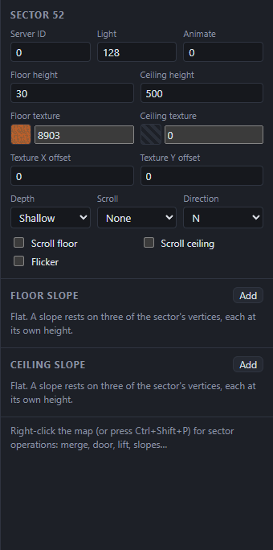
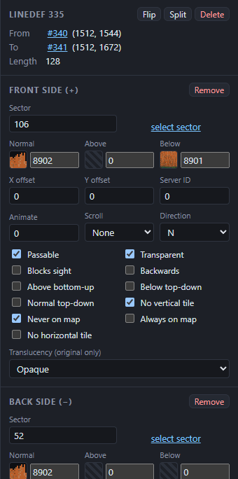
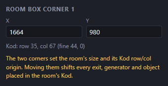
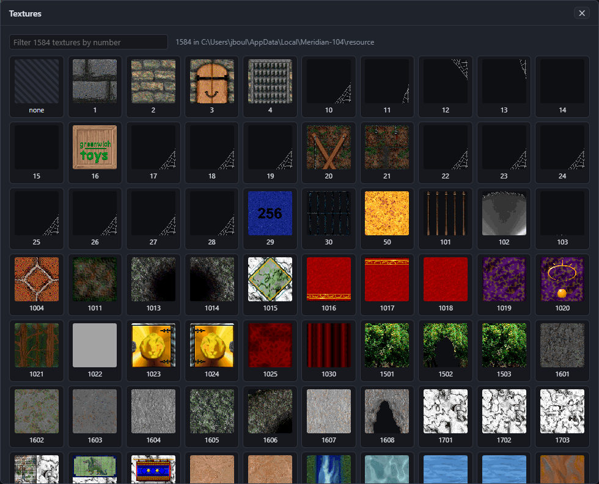

# The inspector

The inspector, on the right, shows every property of the selection. Change a value and it applies straight away:
- **Number fields** commit when you press Enter or leave the field. **Esc** puts the old value back, and **↑ / ↓** step the value by 1 (by 16 with Shift).
- **With several items selected**, a change applies to all of them. Fields where they differ are empty and say "mixed".
- Each change is one undo step.

Below the fields, a hint lists the selection's operations on the right-click menu (see [Operations](08-operations.md)).

## The room (nothing selected)

- **Room ID**: the number the server's Kod uses for this room (its RID).
- Counts of vertices, linedefs, sectors and things; the room's **Size** in squares; and what it **Compiled** to: version, BSP nodes, walls and sides.
- **Target**: the chosen server, with a warning if the room breaks one of its rules.
- **Compatibility**: only for some imported rooms (see [Files](05-files.md#import-a-roo)).
- **Getting around**: a reminder of the keys.

## Sectors

| Field | What it does |
|---|---|
| Server ID | A number the room's Kod uses to change this sector while the game runs (`SetSector`, `SetSectorLight`). 0 for none. **Give a free server id** on the right-click menu picks an unused one. |
| Light | 0–255. From 0 to 127 the sector ignores the room's ambient light; from 128 to 255 it adds to it. 128 is the usual value. |
| Animate | Animation speed for animated floor and ceiling textures. |
| Floor height, Ceiling height | In room units. Keep them at 0 or more for the 104 target. |
| Floor texture, Ceiling texture | Texture numbers; 0 for none. A sector with no ceiling texture is open to the sky. Click the swatch to pick one. |
| Texture X / Y offset | Shift the floor and ceiling textures. |
| Depth | None, Shallow, Deep or Very deep: how far a player sinks into the floor (water, mud). |
| Scroll, Direction | Scrolling speed and direction, for the floor and the ceiling. |
| Scroll floor, Scroll ceiling | Which of the two scroll. |
| Flicker | The sector's light flickers. |

With one sector selected, **Floor slope** and **Ceiling slope** sections follow. See [Slopes](08-operations.md#slopes).

## Linedefs

The top section shows the linedef's two vertices (click one to select it) and its length. **Flip**, **Split** and **Delete** do the same as the right-click menu.

Then come the **Front side (+)** and **Back side (−)** sections. A missing side shows **Add**; **Remove** takes a side away, which makes the linedef one-sided.

| Field | What it does |
|---|---|
| Sector | The sector this side faces. **select sector** selects it. |
| Normal, Above, Below | The side's textures. See [Linedefs and sides](03-room-basics.md#linedefs-and-sides). |
| X offset, Y offset | Shift the side's textures. **Align textures** on the right-click menu sets these along a wall for you. |
| Server ID | A number the room's Kod uses to change this wall while the game runs (`AnimateWall`, `ChangeTexture`). |
| Animate | Animation speed for animated wall textures (tenths of a frame per second). |
| Scroll, Direction | Scroll the wall's texture. |

**Flags:**

| Flag | What it does |
|---|---|
| Passable | Players can walk through. Needed on every two-sided linedef players should cross, such as step and platform edges and doorways. |
| Transparent | Drawn with see-through pixels (fences, grilles). |
| Blocks sight | No line of sight through this wall. |
| Backwards | Mirror the texture left to right. |
| Above bottom-up, Below top-down, Normal top-down | Which edge each texture is pinned to. |
| No vertical tile | Draw the texture once rather than repeating it up the wall. |
| Never on map, Always on map | How the wall shows on the player's automap. |
| No horizontal tile | Original server only. |
| Translucency | Original server only: how see-through the wall is. |

A flag that differs across the selection shows as a mixed checkbox. Clicking it sets the flag on all of them.

## Vertices

One vertex shows its **X** and **Y**, its Kod row and column, and the linedefs that use it (click one to select it). Moving a vertex this way also moves any slope point resting on it.

Several vertices show **Move X by** and **Move Y by**.

## Things

A **room box corner** (the first two things) shows its position and Kod row and column. Moving a corner shifts every exit, generator and object the room's Kod places.

Other things (original target only) also have:
- **Type**, **Angle**, **When / RID** (an exit's destination room), **Flags**, **Exit X** and **Exit Y**;
- **Comment**, roomedit's note for Kod.

## The texture picker

Click any texture swatch in the inspector to choose a texture. **Textures** in the toolbar opens the same browser to look round without changing anything.

- The filter box matches texture numbers: type `96` for every texture starting with 96.
- Click a texture to pick it. **none** clears the field (texture 0).
- The line at the top says how many textures there are and which folder they come from.

You can also type a texture number straight into the field beside the swatch and press Enter.

---

Previous: [Selecting and drawing](06-drawing-and-selecting.md) · Next: [Operations](08-operations.md)
