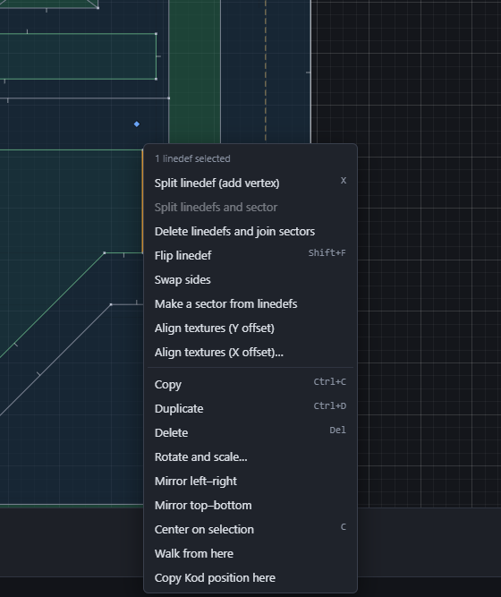

# Operations

Operations are roomedit's editing commands. Select something, then right-click the map: the menu offers the current mode's operations. They're also in the [command palette](02-the-window.md#the-command-palette) (Ctrl+Shift+P), and some have keys.

If an operation can't run, the status bar says why. For example, "A door must connect two other sectors."

## Vertices

| Operation | Key | Needs | What it does |
|---|---|---|---|
| Add vertex at cursor | Ins | fewer than 2 vertices selected | Adds a lone vertex under the mouse. Placed on a linedef, it splits the linedef. |
| Add linedefs between vertices | Ins | 2+ vertices, selected in order | Joins them with linedefs, in the order you selected them. The new linedefs have no sides yet. |
| Add linedefs and close the loop | Shift+Ins | 3+ vertices, in order | The same, plus a linedef from the last back to the first. |
| Delete vertex and join linedefs | | vertices | Removes a vertex that ends one linedef and starts another, joining the two into one. |
| Merge vertices into one | M | 2+ vertices | Everything on the other vertices moves to the first one selected. |
| Add a linedef and split the sector | | 2 vertices on one sector | Draws a linedef between them, cutting the sector in two. |

## Linedefs

| Operation | Key | Needs | What it does |
|---|---|---|---|
| Split linedef (add vertex) | X | linedefs | Adds a vertex in the middle of each. |
| Split linedefs and sector | | 2 linedefs of one sector | Splits both in the middle and joins the new vertices, cutting the sector in two. |
| Delete linedefs and join sectors | | two-sided linedefs | Removes the linedefs and merges the sectors either side into one. |
| Flip linedef | Shift+F | linedefs | Reverses each linedef's direction. Its sides swap too, so each still faces the same sector. |
| Swap sides | | linedefs | Swaps the front and back sides, keeping the direction. |
| Make a sector from linedefs | | linedefs around an area | Adds a new sector on the free side of each linedef. A linedef that already has a front gets a back, and loses its normal texture. The new sector copies the sector the linedefs' fronts face. |
| Align textures (Y offset) | | linedefs | Lines up the Y offsets against the first one's height, so a texture runs on level along a wall. |
| Align textures (X offset)… | | linedefs, in order along a wall | Sets X offsets so a texture runs on from linedef to linedef (see below). |

### Aligning textures along a wall

**Align textures (X offset)…** asks:
- **Side**: front or back;
- **Texture**: Normal, Upper (above) or Lower (below);
- **Initial offset**: where the first linedef starts;
- **Follow the whole loop**: start from one linedef and follow the closed loop it's in, roomedit's "circle" alignment. This is ticked when you've selected only one linedef.

Each offset carries on where the last linedef ended, wrapping at the texture's width.

## Sectors

| Operation | Needs | What it does |
|---|---|---|
| Merge sectors | 2+ sectors | Every side facing the others joins the first sector selected, and the others are deleted. |
| Make door from sector | 1 sector between two others | Turns a doorway sector into a closed door: its ceiling comes down to its floor, and it gets a free server ID so the room's Kod can open it with `SetSector`. The doorway's faces take the wall texture. |
| Make lift from sector | 1 sector next to others | Raises it to the height of its highest neighbour, keeps 56 units of headroom, and gives it a free server ID for Kod. |
| Distribute floor heights | 3+ sectors, in order | Sets even steps of floor height from the first sector selected to the last. Good for stairs. |
| Distribute ceiling heights | 3+ sectors, in order | The same for ceilings. |
| Give a free server id | sectors | Gives each selected sector without a server ID an unused one. |
| Add floor slope | 1 sector | Slopes the floor (see below). |
| Add ceiling slope | 1 sector | Slopes the ceiling. |

### Stairs

1. Draw the stairs as a row of sectors, for example with **Draw lines** across a corridor.
2. Set the floor height of the bottom step and the top step.
3. In Sectors mode, click the bottom step, then Shift-click each step in order up to the top.
4. Right-click and choose **Distribute floor heights**.

Remember that a player can step up 24 units at most.

### Slopes

**Add floor slope** (or **Add** in the inspector's **Floor slope** section) tilts a sector's floor. A slope rests on three of the sector's vertices, each at its own height. They start at the sector's current height.

In the inspector's **Floor slope** section:
- **Point 1**, **Point 2**, **Point 3**: which vertices the slope rests on;
- **Height**: the floor's height at each point;
- **Texture angle**: the direction the floor texture runs, in degrees;
- **Sloped**: turns the slope off without forgetting it;
- **Remove**: deletes the slope.

Ceiling slopes work the same way. Watch the 3D preview as you change the heights.

## Edit operations

These work in every mode, on whatever is selected:
- Copy, Duplicate, Delete;
- Rotate and scale…, Mirror left–right, Mirror top–bottom;
- Center on selection;
- Walk from here;
- Copy Kod position here.

See [Selecting and drawing](06-drawing-and-selecting.md), [3D preview and walking](09-3d-preview-and-walking.md#walk-mode) and [Kod placements](10-kod-placements.md#copy-a-kod-position).

---

Previous: [The inspector](07-inspector.md) · Next: [3D preview and walking](09-3d-preview-and-walking.md)
