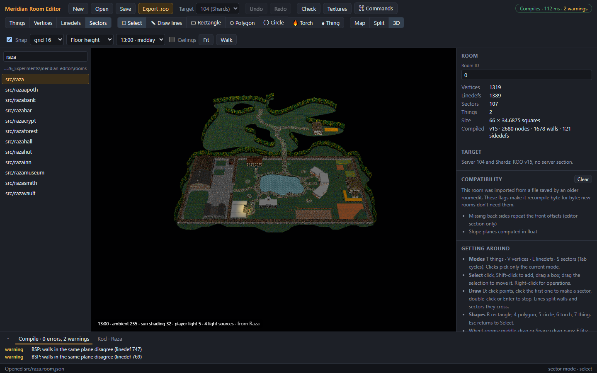
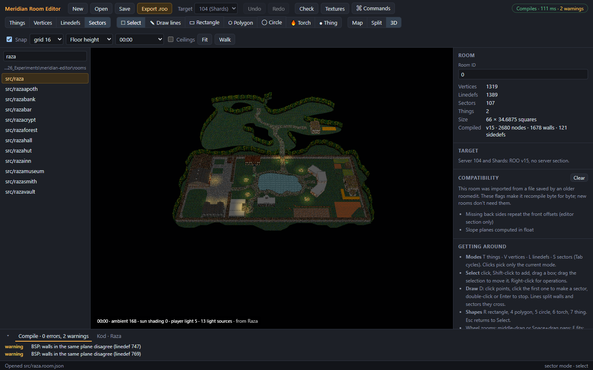
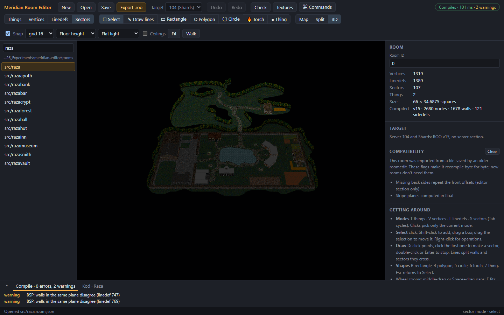
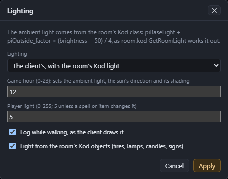
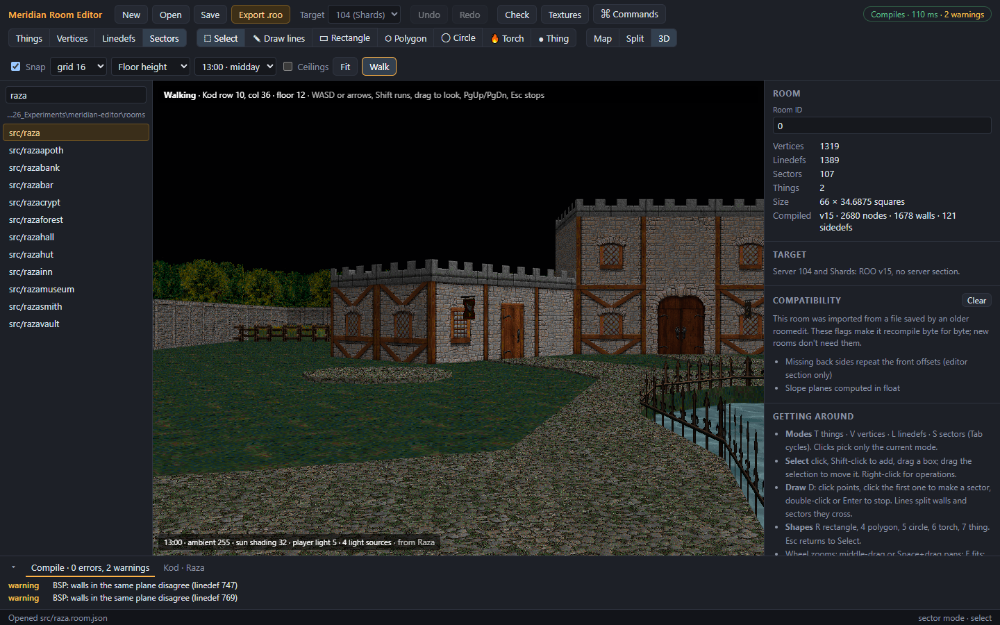

# 3D preview and walking

The 3D preview draws the room the way the game client does: the same walls, floors and ceilings, the same textures and offsets, and the same lighting. It updates after every change, so you can watch an edit take effect.

Show it with **3D** (Ctrl+2), or **Split** (Ctrl+3) to see it beside the map.

## Looking round

- **Left-drag** turns the view round the room.
- **Right-drag** slides it.
- The **mouse wheel** zooms.
- **Click** a floor, ceiling or wall to select its sector.

What you see:
- Textures are drawn with their offsets and flags: top-down and bottom-up, no vertical tile, backwards, see-through, slopes, scrolling and animation.
- A face with no texture shows a **grey checker**.
- A sector with no ceiling texture is open sky, with no ceiling.
- Ceilings are hidden so you can see in from above. Tick **Ceilings** in the toolbar to show them.

## Lighting

The toolbar's hour menu sets the lighting.

**A game hour (00:00 to 23:00)** lights the room as the client would at that hour:
- each sector's own light;
- the room's ambient light, which changes with the time of day for outdoor rooms;
- the player's own light;
- shading from the sun on walls and slopes.

The ambient light and the sun follow the server's Kod: the room class's light settings, the game's brightness at that hour, and the sun's position. The line under the view says what was used. Hover over it to see where each value comes from.

Without a Kod folder, or for a room that has no Kod class yet, the line says **Room's defaults**: the base room class's settings, which are full light and fully outdoors.

**Flat light** ignores the time of day and shows each sector's light level. It's useful for checking light values.

### Light sources

With a Kod folder set, the preview also draws the lights the room's Kod places, the way the client draws them:
- candles, braziers, lamps, torches and other light objects;
- flickering ornaments, signs (a small highlight) and news globes.

Lamps outdoors switch off between 11:00 and 17:00, as they do in the game. Lights that depend on the game's state, such as spells and monsters, aren't shown. On the map, the Kod overlay draws a dashed circle for how far each light reaches.

### The Lighting dialog

**View → Lighting…** (also in the command palette) has more settings:

- **Lighting**: the client's game lighting, or flat.
- **Game hour**: the same as the toolbar menu.
- **Player light**: the light the player carries. It's 5 unless a spell or item changes it.
- **Fog while walking**: the client's distance fog, shown in Walk mode.
- **Light from the room's Kod objects**: turn the light sources on or off.

## Walk mode

Walk mode puts you in the room at a player's eye height, and moves you by the game client's own movement rules.

To start walking:
- choose **Walk** in the toolbar, or press **Shift+W**. You start on the room's Kod arrival square, or in the middle of the first sector;
- or right-click the map and choose **Walk from here** to start at that spot.

If only the map is showing, the editor switches to Split view.

| Key | Does |
|---|---|
| W / S, or ↑ / ↓ | Walk forward and back |
| A / D | Step left and right |
| ← / → | Turn |
| Shift | Run |
| Drag in the view | Look round |
| Page Up / Page Down | Look up and down |
| Home | Look straight ahead |
| Esc | Stop walking |

While you walk:
- the bar at the top shows your Kod row and column and the floor height under you;
- the map shows where you are and which way you're facing;
- ceilings always show, and the fog is on (unless you turned it off);
- you can keep editing on the map, and the preview updates under your feet.

### What stops you

Walk mode moves you exactly as the client does, so it stops you where the game would:
- a **step up of more than 24** units;
- a gap with **less than 48 units** of headroom;
- a two-sided linedef that isn't **Passable**;
- the edge of the room.

If you can't walk somewhere you expect to, check those first. See [Troubleshooting](troubleshooting.md#i-cant-walk-through-an-opening-or-up-a-step).

---

Previous: [Operations](08-operations.md) · Next: [Kod placements](10-kod-placements.md)
