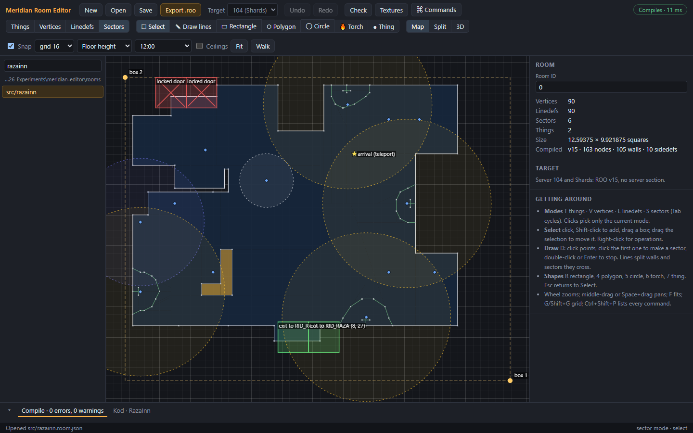
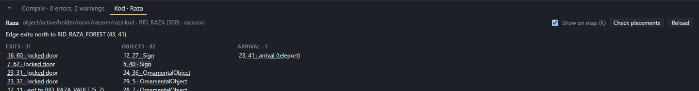

# Kod placements

A Meridian room is two things:
- the **room file** (`.roo`): the floor plan, heights, textures and lighting. This is what the editor builds.
- the room's **Kod class** on the server: exits, monster generators, objects, sounds, and the room's light settings. Builders write it as Kod source.

The editor doesn't edit Kod. It reads it, so you can see where the Kod puts things while you change the room around them. This needs a Kod folder (see [Getting started](01-getting-started.md#kod-optional)).

## On the map

**K** shows or hides the Kod placements on the map.



| Mark | What it is |
|---|---|
| Green square | An exit, labelled with where it goes. |
| Red square with a cross | A locked door. |
| Dashed green bar outside the room box | An edge exit: walking off that side of the room leads to another room. |
| Orange dot | A monster generator. |
| Blue diamond | An object placed by the room (`NewHold` or an ornament list). |
| Purple dot | A looping sound. |
| Yellow star | The arrival square, where players appear. |
| Dashed circle | How far a light reaches, in the light's colour, at the 3D preview's hour. |

Labels appear when you zoom in far enough. The status bar names what's on the square under the mouse.

## The Kod tab

The **Kod** tab in the bottom panel lists the room's class and everything it places.



- The first line gives the class name, its file, its room ID and the `.roo` it uses.
- Edge exits are listed under it.
- The rest is grouped: exits, monster generators, objects, sounds and the arrival square. Each entry gives its Kod row and column. Click one to centre the map on it.
- **Show on map (K)** shows or hides the marks.
- **Check placements** runs the Kod placement check (below).
- **Reload** reads the Kod again after you've changed it.

The editor finds the class by the room's `.roo` name, or by its room ID. When several classes use the same `.roo` (Tos has a few), a menu lets you pick one.

## Checking placements

**Check Kod placements** (also part of **Run all checks**, F9) flags placements that are:
- outside the room box;
- on a square with no floor.

The usual cause is a moved room box corner, or walls moved away from where the Kod expects floor. Click a result to see the spot.

## Copy a Kod position

To place something new in Kod, right-click the spot on the map and choose **Copy Kod position here**. The editor copies the arguments Kod's `NewHold` takes, for example:

```
#new_row=12,#new_col=7,#fine_row=32,#fine_col=16
```

Paste them into the room's Kod class. The inspector also shows the Kod row and column of a selected vertex or thing, and the status bar shows the mouse's.

## Kod rows and columns

- Kod counts rows down and columns across from the room box's top-left corner, starting at 1.
- Each row and column is one 64-unit square, and fine positions divide a square into 64.

This is why the room box matters. If you move a corner, every Kod position in the room shifts with it.

## New rooms and Kod

A new room has no Kod class, so the Kod tab says **none**, nothing shows on the map, and the 3D preview uses the default lighting. For the room to be in the game:
- someone writes a Kod class for it, naming its `.roo` file and its room ID;
- the compiled `.roo` and the class go on the server.

Whoever runs your server will know how. For a local Shards server, the project's [README](../../README.md#testing-rooms-in-shards) describes the tools that install and walk a test room.

---

Previous: [3D preview and walking](09-3d-preview-and-walking.md) · Next: [Checks and export](11-checks-and-export.md)
