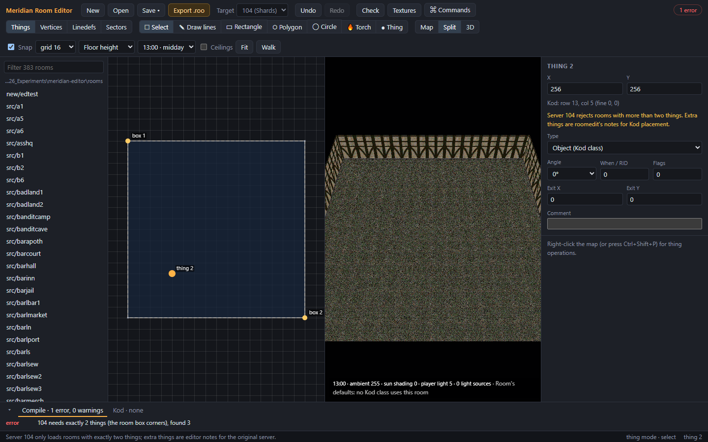
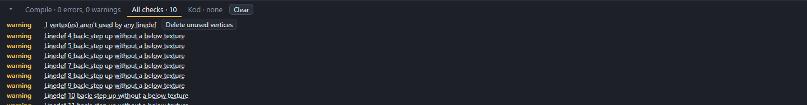
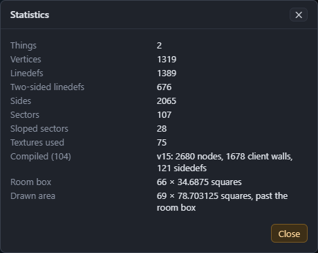
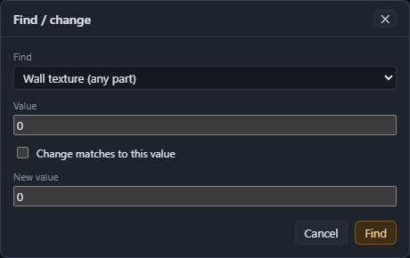

# Checks and export

## Compiling as you work

The editor compiles the room for the toolbar's **Target** after every change, in the background. The chip at the right of the toolbar shows the result:
- green **Compiles · N ms**: the room is ready to export;
- red **N errors**: it isn't. The **Compile** tab in the bottom panel says why.

Warnings are counted after the result. They don't stop an export. Some of the game's own rooms have BSP warnings, for example.

Common errors for the **104** target:

| Error | Fix |
|---|---|
| 104 needs exactly 2 things (the room box corners) | Delete the extra things (Things mode). Place objects in Kod instead. |
| A negative floor or ceiling height | Raise the sector to 0 or more. The inspector warns about this. |
| An original-only wall flag | Untick **No horizontal tile**, and set **Translucency** to Opaque. |

## Checks

roomedit's checks look for mistakes that compile but cause problems in the game. **Check** in the toolbar, or **F9**, runs them all. Each one is also in the **Check** menu and the command palette:

| Check | Looks for |
|---|---|
| Statistics | Not a check: counts of everything in the room, what it compiled to, and its size. |
| Check sectors are closed | Sectors whose sides don't form closed loops, and sides that disagree about which sector they face. |
| Check cross-references | Linedefs with no sides or only a back side, a linedef that uses one vertex twice, references to missing sectors, duplicate linedefs, and unused vertices and sectors. |
| Check missing textures | One-sided walls without a normal texture, steps without a below texture, ceiling drops without an above texture, and sectors without a floor texture (the original server treats those as unwalkable). |
| Check texture names | Textures that aren't in the texture library. |
| Check Kod placements | Kod placements outside the room box or on squares with no floor. See [Kod placements](10-kod-placements.md#checking-placements). |

The results show in the bottom panel:

- Errors and warnings are marked.
- **Click a result** to select the item and centre the map on it.
- Some results have a **fix button**: **Delete duplicates**, **Delete unused vertices** or **Delete unused sectors**. A fix is one undo step, like any other change.
- **Clear** closes the results.

Statistics gives the room's size two ways. **Room box** is the size between the two corners, which is how Kod counts rows and columns, and matches **Size** in the inspector. When walls are drawn outside the room box, as Raza's forest is, **Drawn area** gives the size of everything drawn.

## Finding things

| Command | Shortcut | What it does |
|---|---|---|
| Find / change… | Ctrl+F | Find linedefs or sectors by a value, and optionally change it. |
| Jump to object… | Ctrl+J | Select an item of the current mode by its number. |
| Next object, Previous object | N, P | Select each item of the current mode in turn. |

**Find / change** searches for:
- a wall texture (any part, or just Normal, Upper or Lower);
- a wall server ID;
- a floor or ceiling texture;
- a sector server ID, light, floor height or ceiling height.

Matches are selected, and the map centres on them. Tick **Change matches to this value** and give a **New value** to replace them all. For example, swap every use of one wall texture for another.

## Export a .roo

1. Pick the **Target** in the toolbar: **104 (Shards)** for Server 104 and Meridian Shards, or **Original** for the original server.
2. Choose **Export .roo** (Ctrl+E).
3. Choose where to save the file. The editor remembers the folder.

The status bar confirms the target, the file version (v15 for 104, v13 for Original) and where it went. If the room doesn't compile for the target, nothing is saved, and the status bar shows the first error.

Export doesn't save the room source. **Save** (Ctrl+S) does that.

---

Previous: [Kod placements](10-kod-placements.md) · Next: [Working with an AI agent](12-working-with-an-agent.md)
